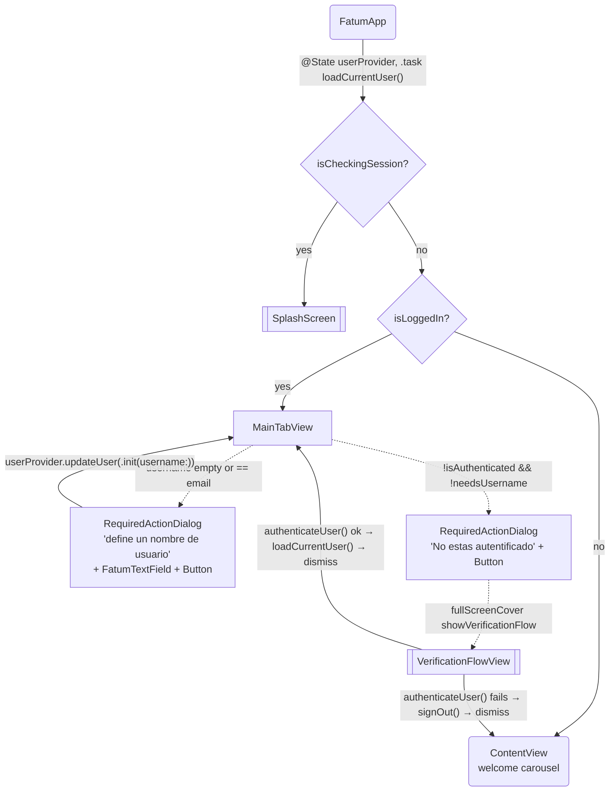
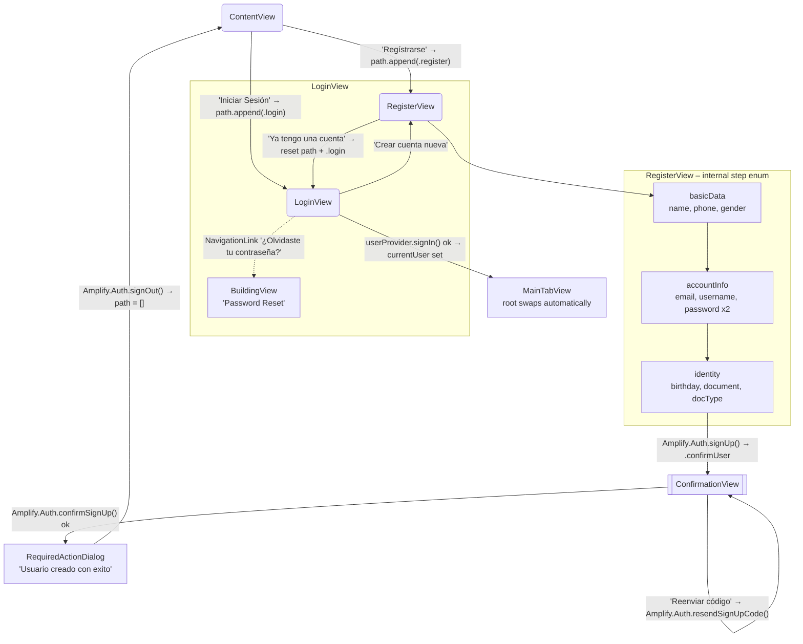
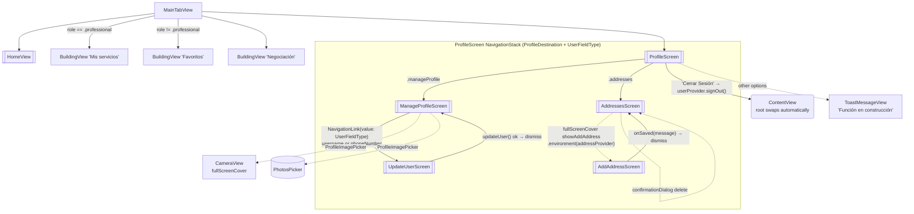
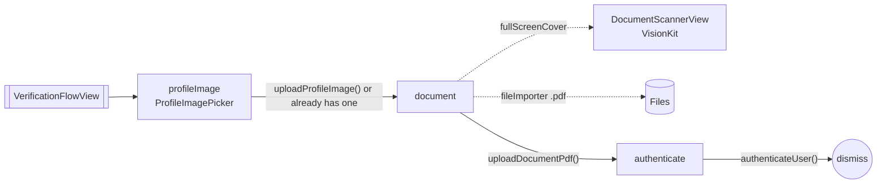
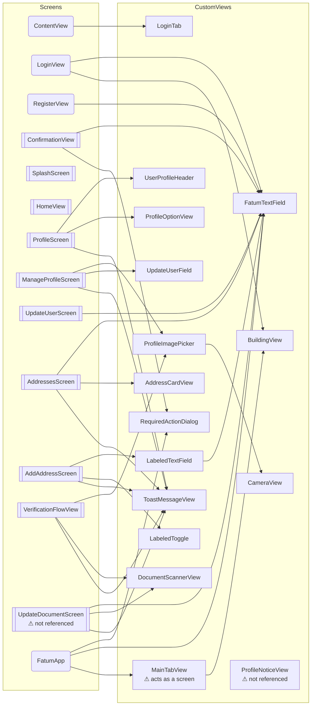
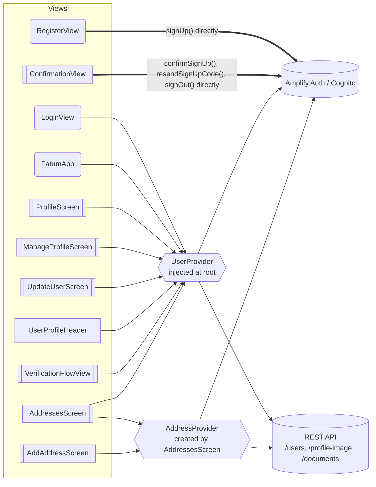

# Fatum – User Flow & View Composition

Generated from the code on 2026-10-15. Mermaid diagrams: open in Xcode Markdown preview, GitHub, or VS Code (Markdown Preview Mermaid).

Legend used across diagrams:

| Shape / style | Meaning |
|---|---|
| `[[Name]]` | File in `Views/Screens` |
| `[Name]` | File in `Views/CustomViews` |
| `(Name)` | Declared outside those folders (`FatumApp.swift`, `ContentView.swift`) |
| `{{Name}}` | `@Observable` provider in `ViewModels` |
| `-->` | push / state switch |
| `-.->` | `fullScreenCover`, `sheet`, overlay or system picker |

---

## 1. App root: session state decides the tree

`FatumApp` is the only place that decides which tree is on screen, based on `UserProvider`.

---

## 2. Unauthenticated flow (`ContentView` NavigationStack + `AppRoute`)

`ContentView` owns a `NavigationPath` and resolves `AppRoute` (`.login`, `.register`, `.confirmEmail(email)`). `LoginView` and `RegisterView` are declared in `ContentView.swift`, not in `Views/Screens`.

Note: after confirming the email the user is sent back to the welcome screen and must log in manually.

---

## 3. Authenticated flow (`MainTabView` and the Profile stack)

### Verification flow (presented by `FatumApp`, not by a tab)

---

## 4. Screen → component composition

Which custom views each screen renders. `FatumTextField` is declared in `LoginTextField.swift`; `CameraView` in `UserProfileHeader.swift`.

Same information as a table:

| Screen | Where declared | Components used | Navigation it owns |
|---|---|---|---|
| FatumApp | `FatumApp.swift` | RequiredActionDialog, FatumTextField, MainTabView | Root switch, `fullScreenCover` → VerificationFlowView |
| SplashScreen | Screens | none | – |
| ContentView | `ContentView.swift` | LoginTab ×3 | `NavigationStack(path)` + `AppRoute` |
| LoginView | `ContentView.swift` | FatumTextField ×2, BuildingView | `NavigationLink` (closure) |
| RegisterView | `ContentView.swift` | FatumTextField ×7, inline Picker/DatePicker | internal `RegisterStep` enum |
| ConfirmationView | Screens | FatumTextField, RequiredActionDialog | pops via `navigationPath` |
| MainTabView | CustomViews | HomeView, BuildingView ×2, ProfileScreen | `TabView` |
| HomeView | Screens | none (inline empty state) | own `NavigationStack` |
| ProfileScreen | Screens | UserProfileHeader, ProfileOptionView ×6–7, ToastMessageView | `NavigationStack(path)` + `ProfileDestination` + `UserFieldType` |
| ManageProfileScreen | Screens | ProfileImagePicker, UpdateUserField ×6, ToastMessageView | `NavigationLink(value:)` |
| UpdateUserScreen | Screens | FatumTextField | `dismiss` |
| AddressesScreen | Screens | FatumTextField, AddressCardView, ToastMessageView | `fullScreenCover` → AddAddressScreen, `confirmationDialog` |
| AddAddressScreen | Screens | LabeledTextField ×5, LabeledToggle, ToastMessageView | own `NavigationStack`, `dismiss` |
| VerificationFlowView | Screens | ProfileImagePicker, DocumentScannerView, ToastMessageView | internal `VerificationStep` enum, `fullScreenCover`, `fileImporter` |
| UpdateDocumentScreen | Screens | FatumTextField, DocumentScannerView, ToastMessageView | internal `DocumentStep` enum. **Unused.** |

---

## 5. Data flow: who talks to the backend

Thick arrows are the places where a view bypasses the provider layer.

---

## 6. Observations for the design-pattern review

The intended pattern reads as **MVVM with `@Observable` providers injected through the environment** (`UserProvider`, `AddressProvider`). Points where the code departs from it or from its own conventions:

1. **Providers bypassed in sign-up.** `RegisterView` and `ConfirmationView` call `Amplify.Auth` directly, while `LoginView` goes through `UserProvider.signIn`. Sign-up, confirm, and resend have no provider method.
2. **Business logic in the `App` struct.** `FatumApp` holds form state and `submitUsername()` for the username dialog, plus the "needs authentication" rule. Both are view-model concerns.
3. **Screen placement and naming are mixed.** `LoginView` and `RegisterView` live in `ContentView.swift`; `MainTabView` is a screen container but sits in `CustomViews`; `Screens` mixes `*View` and `*Screen` suffixes; `ContentView` is really a welcome screen.
4. **File/type mismatches.** `FatumTextField` is in `LoginTextField.swift`; `CameraView` is in `UserProfileHeader.swift`; `UserFieldType` is in `ManageProfileScreen.swift`; `AppRoute` is in `ContentView.swift`.
5. **Dead code.** `UpdateDocumentScreen` and `ProfileNoticeView` are not referenced by any other file.
6. **Four navigation styles coexist.** Typed `NavigationPath` + route enum (ContentView, ProfileScreen), `NavigationLink(value:)` (ManageProfileScreen), `NavigationLink { destination }` (LoginView → BuildingView), and in-screen step enums (Register, Verification, UpdateDocument). `ManageProfileScreen` depends on `ProfileScreen` having registered the `UserFieldType` destination.
7. **Duplicated UI logic.** The toast overlay with a 3-second timer is copied in six screens. The capsule step indicator is copied in three. The icon/title/message empty-state block is copied in `HomeView` and `AddressesScreen`. Every view recomputes `ResponsiveLayout` from the size class.
8. **No network layer.** Both providers build `URLRequest`s by hand and duplicate `fetchIdToken`, `authorizedRequest`-style setup, `parseErrorMessage`, and the base URL. `UserProvider.loadCurrentUser` force-casts the response.
9. **Multiple sources of truth for the avatar.** `UserProfileHeader`, `ManageProfileScreen`, and `VerificationFlowView` each fetch the profile-image URL independently instead of reading it from the provider.
10. **Three `NavigationStack`s inside `MainTabView` tabs plus one in `VerificationFlowView` and one in `AddAddressScreen`.** That is normal for tabs, but the covers only need a stack for the toolbar.
